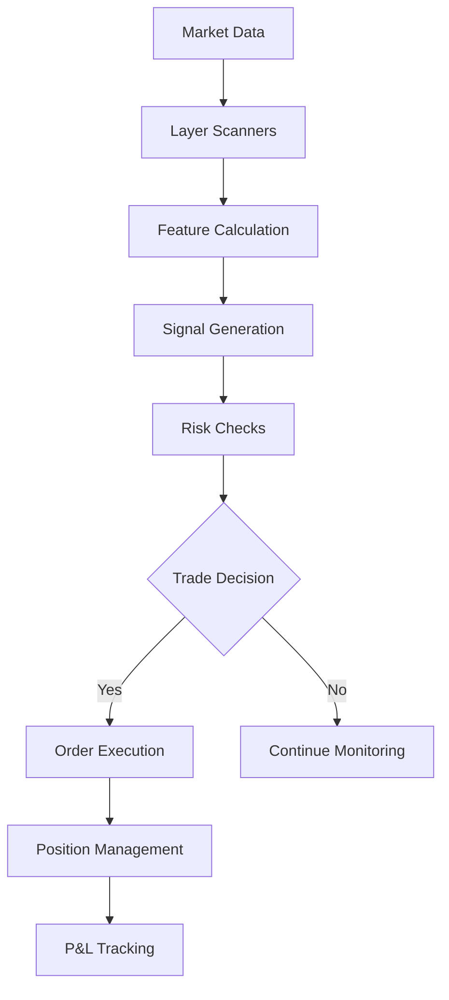

# 🎯 Hunter-Killer Trading System Implementation Guide

## System Overview

This document provides a complete guide to implementing and running the Hunter-Killer automated trading system.

## Current System Status (December 2024 - Phase 1 COMPLETE)

### ✅ What's Working

- **CLI System**: Unified `ai_trader.py` command-line interface (Phase 0 COMPLETE)
- **Database**: PostgreSQL `ai_trader` database with 1094 tables - fully connected
- **Market Data**: Both Polygon and Alpaca providers integrated (Phase 1 COMPLETE)
- **Backfill Command**: Historical data ingestion working for market data, news, and fundamentals
- **Paper Trading**: Both PaperBroker and AlpacaBroker working
- **Architecture**: Clean DDD structure with DI container
- **System Status**: Full health check and monitoring commands

### 🚧 In Progress (Migration Plan Active)

- **Phase 0**: ✅ CLI Foundation COMPLETE
  - `ai_trader.py status` - System health check working
  - `ai_trader.py version` - Version info working
  - All 12 CLI tests passing

- **Phase 1**: ✅ Data Pipeline COMPLETE
  - Created data provider infrastructure at `src/infrastructure/data/providers/`
  - Implemented PolygonDataProvider with rate limiting and error handling
  - Implemented AlpacaDataProvider as fallback option
  - Created DataProviderFactory with auto-detection and multi-source support
  - Implemented `backfill` command with full options:
    - Symbol-based or layer-based backfilling
    - Multiple timeframes (1Min to 1Day)
    - Market data, news, and fundamentals support
    - Provider selection (Polygon, Alpaca, or auto)

### ❌ What's Being Migrated (Phases 2-7)

- **Phase 2**: Scanner System (14 scanners from old system) - NEXT
- **Phase 3**: Feature Pipeline (227+ features)
- **Phase 4**: ML Models and prediction engine
- **Phase 5**: Trading Engine with strategies
- **Phase 6**: Risk management and monitoring
- **Phase 7**: Cleanup and optimization

## Database Configuration

**IMPORTANT**: The database is `ai_trader`, NOT `trading_db`

```bash
# Connection string
postgresql://zachwade:@localhost:5432/ai_trader

# Test connection
psql -d ai_trader -c "SELECT COUNT(*) FROM companies;"
```

### Key Tables

- `market_data` - OHLCV price data
- `features` - Calculated technical indicators
- `companies` - Symbol metadata and layer assignments
- `scanner_alerts` - Trading signals
- `ensemble_signals` - ML model outputs

## Quick Start (For Market Open)

### 1. Set Environment Variables

```bash
export DATABASE_URL="postgresql://zachwade:@localhost:5432/ai_trader"
export ALPACA_API_KEY="PKS2W3CPPQSENT13DOEF"
export ALPACA_SECRET_KEY="2e2TQTEL6gOkZJt1jTRdUJgD7jhk0EWWoIgQ3PO1"
export POLYGON_API_KEY="J0_RjBPCFdOUqn8mGn2QPiET_N9mzgYk"
```

### 2. Check System Status

```bash
cd /Users/zachwade/StockMonitoring
python ai_trader.py status        # Check all systems
python ai_trader.py version       # Show version info
python ai_trader.py --help        # Show all commands
```

### 3. Backfill Data (✅ WORKING)

```bash
# Backfill specific symbols
python ai_trader.py backfill --symbols AAPL,NVDA,MSFT --days 30

# Backfill entire layer
python ai_trader.py backfill --layer layer1 --days 30

# Backfill with specific timeframe
python ai_trader.py backfill --symbols AAPL --days 7 --timeframe 5Min

# Backfill news and fundamentals
python ai_trader.py backfill --symbols AAPL --data-type all
```

### 4. Start Trading (When Implemented)

```bash
# Paper trading (coming in Phase 5)
python ai_trader.py trade --mode paper --strategy momentum

# Scan for opportunities (coming in Phase 2)
python ai_trader.py scan --symbols AAPL,NVDA,MSFT
```

## System Architecture

### Two Systems to Integrate

1. **NEW System** (`/StockMonitoring/src/`)
   - Clean architecture
   - 208 Python files
   - Working brokers and entities
   - Missing strategies and ML

2. **OLD System** (`/StockMonitoring/ai_trader_old/`)
   - Complete trading platform
   - 787+ Python files
   - All strategies, scanners, ML models
   - Production-tested components

### Integration Strategy

```python
# Bridge pattern to use old components in new system
import sys
sys.path.append('/Users/zachwade/StockMonitoring/ai_trader_old/src')

# Import scanners
from main.scanners.catalysts.technical_scanner import TechnicalScanner
from main.scanners.catalysts.volume_scanner import VolumeScanner

# Import strategies
from main.models.strategies.ml_momentum import MLMomentumStrategy
from main.models.strategies.mean_reversion import MeanReversionStrategy

# Import feature engine
from main.feature_pipeline.unified_feature_engine import UnifiedFeatureEngine
```

## Trading Components

### 1. Layer-Based Symbol Management

- **Layer 0**: Universe (~10,000 symbols) - Basic monitoring
- **Layer 1**: Liquid (~2,000 symbols) - Enhanced data, 15-min bars
- **Layer 2**: Catalyst (~500 symbols) - Active monitoring, 5-min bars
- **Layer 3**: Active (~50 symbols) - Real-time trading, tick data

### 2. Scanner Pipeline

Available scanners in `ai_trader_old/src/main/scanners/catalysts/`:

- `technical_scanner.py` - RSI, MACD, Bollinger Bands
- `volume_scanner.py` - Volume spikes and anomalies
- `momentum_scanner.py` - Price momentum detection
- `news_scanner.py` - News sentiment analysis
- `options_scanner.py` - Unusual options activity
- `social_scanner.py` - Social media sentiment

### 3. Trading Strategies

Available strategies in `ai_trader_old/src/main/models/strategies/`:

- `ml_momentum.py` - ML-based momentum trading
- `mean_reversion.py` - Statistical mean reversion
- `breakout.py` - Price breakout detection
- `pairs_trading.py` - Statistical arbitrage
- `regime_adaptive.py` - Market regime detection

### 4. Risk Management

```python
# Position sizing
MAX_POSITION_SIZE = 0.02  # 2% of account per trade
STOP_LOSS = 0.02  # 2% stop loss
TAKE_PROFIT = 0.04  # 4% take profit (2:1 R/R)

# Portfolio limits
MAX_POSITIONS = 10
MAX_SECTOR_EXPOSURE = 0.30  # 30% max in one sector
MAX_DAILY_LOSS = 0.05  # 5% daily loss limit
```

## Implementation Plan (UPDATED - Migration Strategy)

### ✅ Phase 0: CLI Foundation (COMPLETE)

1. Created unified `ai_trader.py` CLI entry point
2. Implemented `status` command with full system health check
3. Implemented `version` command with system info
4. Created test suite (12 tests, all passing)
5. Connected to database (1094 tables found)
6. Integrated with brokers (Paper and Alpaca)

### ✅ Phase 1: Data Pipeline Migration (COMPLETE)

1. ✅ Migrated data ingestion from old system
2. ✅ Ported Polygon and Alpaca data providers
3. ✅ Implemented `backfill` command with full functionality
4. ✅ Created data provider infrastructure with factory pattern

### Phase 2: Scanner System (14 scanners)

1. Port all scanners from old system
2. Create scanner orchestrator
3. Implement `scan` command
4. Database persistence for signals

### Phase 3: Feature Pipeline (227+ features)

1. Port feature calculators
2. Implement `features calculate` command
3. Create feature repository
4. Performance optimization

### Phase 4: ML Models

1. Port prediction engine
2. Migrate trained models
3. Implement `train` and `predict` commands
4. Model versioning system

### Phase 5: Trading Engine

1. Port all strategies
2. Implement `trade` command
3. Position management
4. Real-time execution

### Phase 6: Risk & Monitoring

1. Port risk management
2. Implement `monitor` command
3. Alert system
4. Performance tracking

### Phase 7: Cleanup & Documentation

1. Remove old test scripts
2. Full system testing
3. Performance optimization
4. Complete documentation

## Trading Workflow



## Key Commands

### Database Operations

```bash
# Check database tables
psql -d ai_trader -c "\dt"

# View recent market data
psql -d ai_trader -c "SELECT * FROM market_data WHERE symbol='AAPL' ORDER BY timestamp DESC LIMIT 10;"

# Check scanner alerts
psql -d ai_trader -c "SELECT * FROM scanner_alerts WHERE created_at > NOW() - INTERVAL '1 hour';"
```

### Trading Operations

```bash
# Start paper trading
python paper_trading_alpaca.py

# Run scanner
python -c "from ai_trader_old.src.main.scanners.catalysts.technical_scanner import TechnicalScanner; scanner = TechnicalScanner(); print(scanner.scan(['AAPL', 'MSFT']))"

# Check positions
python -c "from src.infrastructure.brokers.paper_broker import PaperBroker; broker = PaperBroker(); print(broker.get_positions())"
```

## Monitoring & Debugging

### Log Files

- Trading logs: `logs/trading.log`
- Scanner logs: `logs/scanner.log`
- Error logs: `logs/error.log`

### Performance Metrics

```python
# Key metrics to track
metrics = {
    'win_rate': wins / total_trades,
    'avg_win': sum(winning_trades) / wins,
    'avg_loss': sum(losing_trades) / losses,
    'profit_factor': gross_profit / gross_loss,
    'sharpe_ratio': (returns.mean() / returns.std()) * sqrt(252),
    'max_drawdown': (peak - trough) / peak
}
```

## Troubleshooting

### Common Issues

1. **Database Connection Failed**
   - Check PostgreSQL is running: `pg_ctl status`
   - Verify database exists: `psql -l | grep ai_trader`
   - Check credentials in .env file

2. **API Rate Limits**
   - Reduce concurrent API calls
   - Add delays between requests
   - Use cached data when possible

3. **No Trading Signals**
   - Check market hours (9:30 AM - 4:00 PM ET)
   - Verify scanner thresholds
   - Check symbol liquidity

## Next Steps

1. **Immediate** (Before Market Open)
   - Test database connection
   - Verify API keys
   - Run paper trading test

2. **Today**
   - Execute 1+ automated trades
   - Monitor performance
   - Log all signals

3. **This Week**
   - Port 3+ scanners
   - Implement ML predictions
   - Add WebSocket streaming

4. **This Month**
   - Full system integration
   - Performance optimization
   - Live trading preparation

## Resources

- Old System Docs: `/ai_trader_old/CLAUDE.md`
- API Documentation:
  - Alpaca: <https://alpaca.markets/docs/>
  - Polygon: <https://polygon.io/docs/>

## Contact & Support

System created by: Zach Wade
Repository: <https://github.com/zach-wade/AiStockTrader>
Last Updated: December 2024
